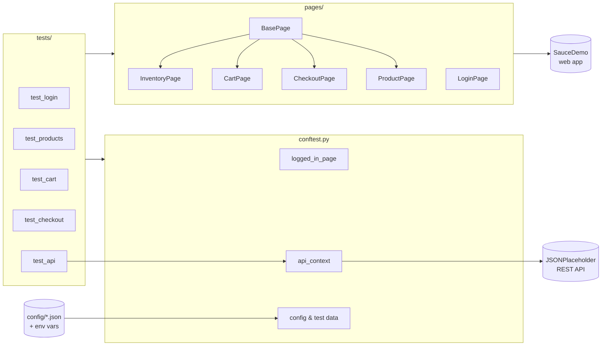

# E-commerce UI & API Test Automation Framework

[](https://github.com/masud-dot/ecommerce-playwright-pytest/actions/workflows/tests.yml)
[](https://masud-dot.github.io/ecommerce-playwright-pytest/)


[](https://github.com/astral-sh/ruff)
[](LICENSE)

An end-to-end test automation framework built with **Python, Playwright and Pytest**, covering the
[SauceDemo](https://www.saucedemo.com/) e-commerce web app (UI) and the
[JSONPlaceholder](https://jsonplaceholder.typicode.com/) REST API. It runs **85 tests** across
**Chromium, Firefox and WebKit** on every push. CI publishes an **Allure report** to GitHub Pages.

📊 **Live test report:** https://masud-dot.github.io/ecommerce-playwright-pytest/

---

## Highlights

| Capability | Implementation |
|---|---|
| **Page Object Model** | `BasePage` with shared header/cart/menu components, inherited by each page object |
| **Cross-browser** | Chromium, Firefox and WebKit via a GitHub Actions matrix |
| **UI + API in one framework** | Playwright `APIRequestContext` for REST tests (CRUD, filtering, 404, schema checks) |
| **Data-driven tests** | `pytest.mark.parametrize` with readable test IDs (e.g. `missing-postal-code`) |
| **Test isolation** | Fresh browser context per test plus explicit storage reset; tests run in any order and in parallel |
| **Parallel execution** | `pytest-xdist` (`-n auto`) |
| **Stable, flake-resistant waits** | Web-first `expect` assertions and URL-based navigation waits; no `sleep()` calls |
| **Reporting** | Allure (features/stories/steps, failure screenshots) and a self-contained pytest-html report |
| **Debugging artifacts** | Playwright traces, screenshots and videos retained for failed tests |
| **Configurable environments** | `--env` option, JSON config, and environment-variable overrides for URLs and credentials |
| **Test tagging** | `smoke`, `regression` and `api` markers for selective runs |
| **Code quality** | Type hints throughout, `ruff` lint and format checks enforced in CI |
| **CI/CD** | Lint, then a 3-browser test matrix, then an Allure report deployed to GitHub Pages; nightly scheduled run |

## Architecture



Tests describe **what** is being verified. Page objects own **how** to interact with the UI
(locators and actions). Fixtures handle setup such as authentication, configuration and API clients.

## Project structure

```text
.
├── .github/workflows/tests.yml   # CI: lint, 3-browser matrix, Allure report to GitHub Pages
├── config/
│   ├── environments.json         # Base URLs per environment
│   └── test_data.json            # Demo users and checkout data
├── pages/                        # Page Object Model
│   ├── base_page.py              # Shared header: title, cart badge, side menu, logout
│   ├── login_page.py
│   ├── inventory_page.py
│   ├── product_page.py
│   ├── cart_page.py
│   └── checkout_page.py
├── tests/
│   ├── test_login.py             # Valid/invalid login, locked user, access control, logout
│   ├── test_products.py          # Inventory, 4 sort modes, product details
│   ├── test_cart.py              # Add/remove items, multiple items, persistence
│   ├── test_checkout.py          # Form validation, price calculation, cancel, full order
│   └── test_api.py               # GET/POST/PUT/PATCH/DELETE, filtering, 404, schema
├── utils/config_loader.py        # Config + env-var override loader
├── conftest.py                   # Fixtures, CLI options, Allure failure screenshots
├── pyproject.toml                # Pytest, markers and ruff configuration
├── requirements.txt              # Runtime dependencies
└── requirements-dev.txt          # Runtime + lint tooling
```

## Test coverage

| Feature | Scenarios | Tests per browser |
|---|---|---|
| Authentication | Valid login, 5 invalid-credential cases, locked-out user, unauthenticated access is blocked, logout | 9 |
| Product catalogue | Inventory integrity (count, unique names, prices), sorting A–Z / Z–A / price low–high / high–low, product details and back navigation | 6 |
| Shopping cart | Add item, remove from cart page, remove from inventory page, multiple items, cart persists after "Continue Shopping" | 5 |
| Checkout | Required-field validation (first name, last name, postal code), **subtotal + tax = total**, cancel returns to cart, complete order end to end | 6 |
| REST API | GET by id with schema check, 404 for missing resource, query filtering, POST, PUT, PATCH, DELETE | 7 |

**26 UI tests × 3 browsers + 7 API tests = 85 test executions per run.**

## Getting started

### Prerequisites

- Python 3.11+ (3.12 recommended)
- Git

### Installation

```bash
git clone https://github.com/masud-dot/ecommerce-playwright-pytest.git
cd ecommerce-playwright-pytest

python -m venv .venv
# Windows (PowerShell):  .\.venv\Scripts\Activate.ps1
# macOS / Linux:         source .venv/bin/activate

pip install -r requirements-dev.txt
playwright install chromium firefox webkit
```

## Running tests

```bash
pytest                                                    # full suite on Chromium (default)
pytest --browser firefox                                  # a single other browser
pytest --browser chromium --browser firefox --browser webkit   # all three browsers
pytest -n auto                                            # run in parallel
pytest -m smoke                                           # critical-path tests only
pytest -m api                                             # API tests only
pytest tests/test_checkout.py                             # a single module
pytest --headed --slowmo 500                              # watch the browser
pytest --env qa                                           # choose a configured environment
```

### Configuration via environment variables

URLs and the standard user's credentials can be overridden without editing code (see `.env.example`):

| Variable | Default |
|---|---|
| `BASE_URL` | `https://www.saucedemo.com/` |
| `API_BASE_URL` | `https://jsonplaceholder.typicode.com` |
| `SAUCEDEMO_USERNAME` | `standard_user` |
| `SAUCEDEMO_PASSWORD` | `secret_sauce` |

> The bundled credentials are SauceDemo's **public demo credentials**. Real secrets belong in CI secrets, never in Git.

## Reports and debugging

Every run produces:

- **`reports/pytest-report.html`**: a self-contained HTML report
- **`reports/allure-results/`**: raw Allure results (features, stories, steps, failure screenshots)
- **`test-results/`**: Playwright traces, screenshots and videos for failed tests

```bash
# Allure (requires Java 17+ and the Allure CLI)
allure serve reports/allure-results

# Step through a failed test's trace in the Playwright Trace Viewer
playwright show-trace test-results/<test-name>/trace.zip
```

In CI, each browser job uploads its reports as workflow artifacts. The `main` branch publishes the
merged Allure report to [GitHub Pages](https://masud-dot.github.io/ecommerce-playwright-pytest/).

## CI/CD pipeline

```text
push / PR / nightly
   └── lint (ruff check + format)
         └── test matrix ── chromium ─┐
                         ├─ firefox  ─┼── merge Allure results ── deploy to GitHub Pages
                         └─ webkit   ─┘
```

Tests that hit a network timeout against the public demo sites are retried once
(`--only-rerun TimeoutError`). Assertion failures are **never** retried, so real defects are not hidden.

## Design decisions

- **Locators** prefer `data-test` attributes and accessible roles/placeholders over CSS structure, which keeps them resilient to styling changes.
- **No hard waits.** Synchronisation uses Playwright's auto-waiting, web-first `expect` assertions and URL waits on navigation. That eliminated race conditions where SauceDemo's single-page routing reuses the same `data-test` IDs across pages.
- **Isolation first.** Each test gets a new browser context and starts with cleared storage, so tests are order-independent and safe to run in parallel.
- **Assertions live in tests** (business intent). Page objects expose actions, state and reusable `expect_*` helpers.
- **API tests** use Playwright's request context, so UI and API checks share one toolchain, one config and one report.

## Notes

This is an independent portfolio project. SauceDemo and JSONPlaceholder are public third-party demo
services and are not affiliated with this repository. JSONPlaceholder fakes write operations, so
POST/PUT/PATCH/DELETE responses are validated but the data is not persisted.

## Author

**Masud Mondal** · [GitHub @masud-dot](https://github.com/masud-dot)

## License

Released under the [MIT License](LICENSE).
